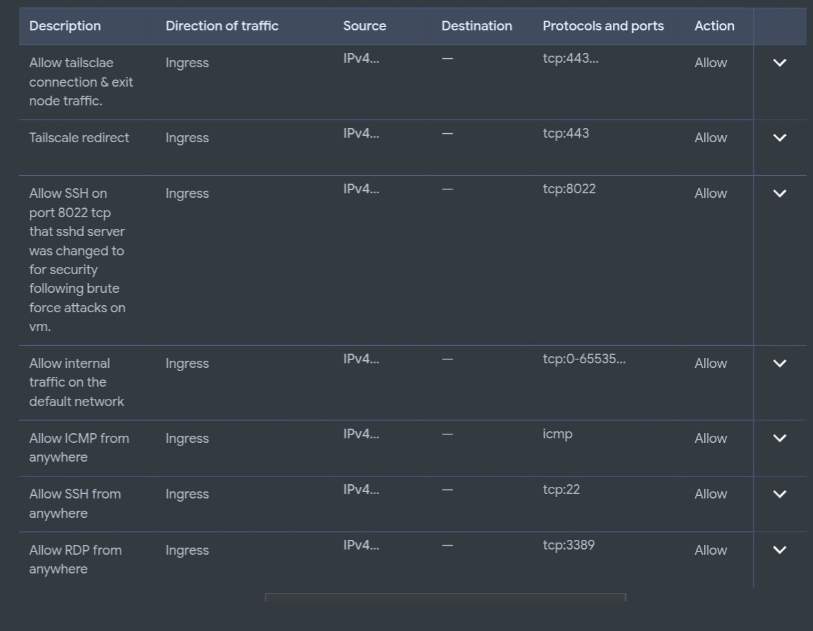
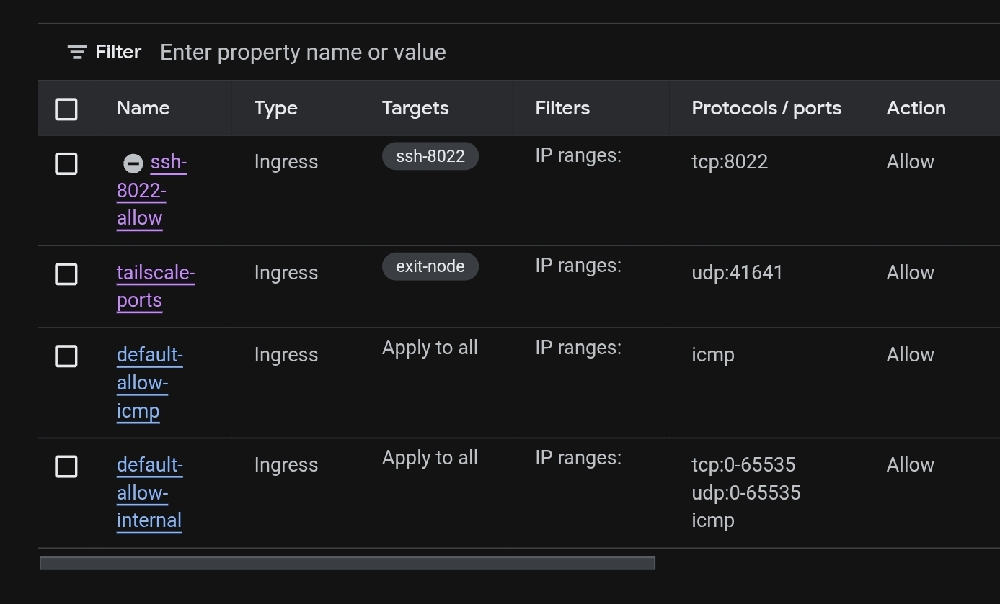
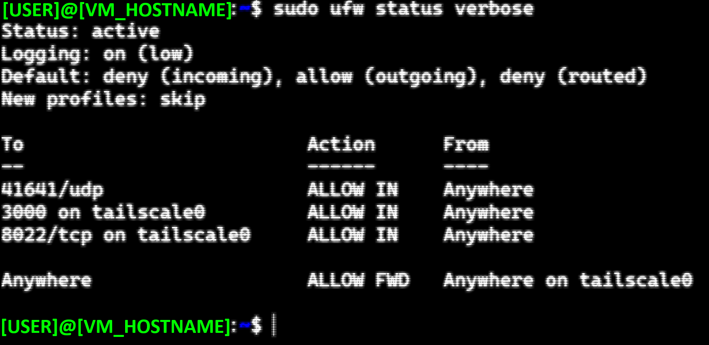
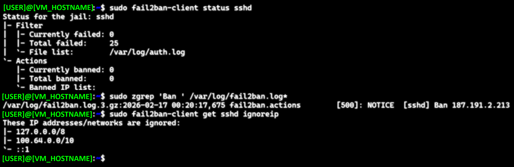
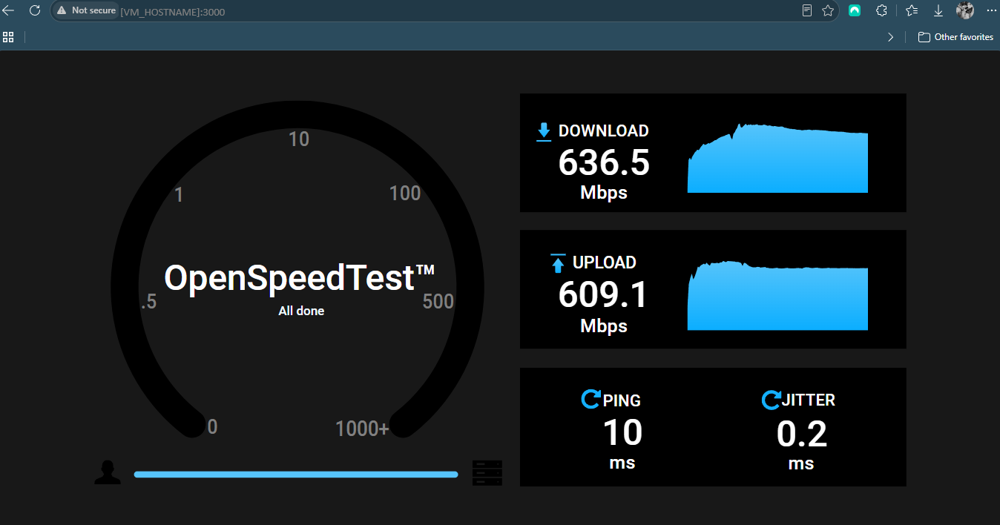

### Zero-Trust Cloud Hardening and Post-Quantum SSH Implementation.md`

# Zero-Trust Cloud Hardening and Post-Quantum SSH Implementation

> **Author:** Zachary V. Martin, CC | **Date:** November 17, 2026 | **Environment:** Debian 12 ([VM_HOSTNAME]) on Google Cloud Platform (GCP), Tailscale Mesh Overlay, Windows 11 Administrative Workstation

> **Sanitization Note:** Public host IPv4 addresses, VPN overlay endpoints, and local system identifiers have been replaced with RFC 5737 TEST-NET documentation ranges and generic placeholders to preserve operational security (OPSEC). External threat telemetry, attacker source IPs, ASNs, and timestamps remain unedited to preserve forensic and threat-intelligence integrity.

## Executive Summary

Public-facing cloud virtual machines are continuously targeted by automated reconnaissance and brute-force credential stuffing. Rather than relying solely on security-through-obscurity (custom ports) or reactive intrusion prevention, this project re-architected a production Debian 12 cloud node into a dark, zero-trust endpoint. By eliminating public TCP ingress at both the cloud provider edge and host firewall, binding administrative and diagnostic services exclusively to a WireGuard-based Tailscale overlay network, and enforcing hybrid post-quantum key exchange (`sntrup761x25519-sha512@openssh.com`), the node achieved complete invisibility to external network scanners while defending administrative sessions against future quantum-enabled decryption ("harvest now, decrypt later" attacks).

## 1. Threat Model & Initial Posture

Prior to remediation, the cloud instance ([VM_HOSTNAME]) exposed a custom SSH port (`8022/tcp`) and legacy reverse-proxy web ports (`443/tcp`) to the public internet (`0.0.0.0/0`). Although protected by passphrase-encrypted ED25519 keys and Fail2Ban, external port exposure still generated continuous unsolicited connection attempts in `/var/log/auth.log` and left administrative transport reliant on classical elliptic-curve key exchange algorithms (`curve25519-sha256`), which are vulnerable to Shor's algorithm on cryptographically relevant quantum computers.

### Core Objectives

1. **Zero Public Attack Surface:** Remove all public TCP ingress rules at the GCP VPC firewall and host UFW levels so external probes are silently dropped at the network edge.
2. **Overlay-Exclusive Service Binding:** Restrict SSH (`8022/tcp`) and internal network throughput diagnostics (OpenSpeedTest on `3000/tcp`) strictly to the encrypted `tailscale0` virtual interface (`100.64.0.0/10`).
3. **Compartmentalized Key Management:** Maintain hardware-isolated, per-device ED25519 keypairs in local vaults without cloud-synced keychains or third-party SSH brokers.
4. **Post-Quantum Cryptographic Hardening:** Mandate hybrid post-quantum key exchange across both client and server OpenSSH configurations, eliminating classical-only negotiation fallbacks.

## 2. Layered Network Isolation (Defense-in-Depth)

To ensure no single misconfiguration could expose internal services, ingress filtering was enforced across two independent layers.

| Security Layer | Control Mechanism | Configuration Applied | Operational Effect |
| :--- | :--- | :--- | :--- |
| **Cloud Perimeter** | GCP VPC Firewall | Deleted legacy `tcp:22`, `tcp:443`, and `tcp:3389` rules; stripped `tcp:443` from `tailscale-ports` (leaving only `udp:41641` for direct NAT traversal); paused `ssh-8022-allow` as an offline break-glass control. | Unsolicited TCP SYN packets are blackholed at Google's network edge before reaching the VM NIC. |
| **Host Firewall** | Uncomplicated Firewall (UFW) | Stripped all public ingress and legacy proxy rules; restricted `8022/tcp` and `3000/tcp` explicitly to `in on tailscale0`; retained `ALLOW FWD on tailscale0` for exit-node routing. | Even if a cloud firewall rule is temporarily re-enabled, the host kernel drops non-Tailscale packets. |
| **Intrusion Prevention** | Fail2Ban (`sshd` jail) | Verified active `auth.log` monitoring and added `100.64.0.0/10` to `ignoreip` via `/etc/fail2ban/jail.d/99-tailscale-ignore.conf`. | Prevents accidental administrative lockouts on the overlay while maintaining automated banning during break-glass maintenance. |

## 3. Post-Quantum SSH Cryptographic Upgrade

Securing the transport layer required aligning both the server daemon and the Windows administrative workstation to support hybrid post-quantum key exchange—combining Streamlined NTRU Prime (`sntrup761`), a lattice-based post-quantum KEM, with classical X25519.

### Deployment Steps

1. **Client Toolchain Modernization:** Replaced the legacy Windows System32 OpenSSH binary with `OpenSSH_for_Windows_10.4p1` (LibreSSL 4.3.3) via Winget and prioritized `C:\Program Files\OpenSSH\` in the system PATH, unlocking native `sntrup761x25519-sha512@openssh.com` and `mlkem768x25519-sha256` support.
2. **Server Policy Enforcement:** Deployed a dedicated drop-in configuration (`/etc/ssh/sshd_config.d/99-post-quantum-kex.conf`) on Debian 12 (`OpenSSH_9.2p1`) restricting `KexAlgorithms` exclusively to `sntrup761x25519-sha512@openssh.com`, validated with `sshd -t` and `sshd -T`.
3. **Client Configuration Pinning:** Hardened `~/.ssh/config` with `IdentitiesOnly yes`, `ForwardAgent no`, and explicit algorithm pinning (`KexAlgorithms sntrup761x25519-sha512@openssh.com`, `Ciphers chacha20-poly1305@openssh.com`, `HostKeyAlgorithms ssh-ed25519`) to prevent downgrade attacks.

This creates a nested cryptographic architecture: SSH traffic encrypted with ChaCha20-Poly1305 and negotiated via hybrid post-quantum `sntrup761x25519` travels inside a peer-to-peer WireGuard (ChaCha20-Poly1305) Tailscale tunnel.

## 4. Verification & Validation Testing

Post-implementation verification confirmed both external invisibility and internal performance.

* **External Port Reconnaissance (`nmap -Pn -p 22,443,3000,3389,8022`):** Scanning the VM's public IPv4 address returned "filtered" across all five ports, confirming zero TCP response packets at the GCP edge.
* **Cryptographic Handshake Audit (`ssh -v`):** Verbose client negotiation confirmed active use of `sntrup761x25519-sha512@openssh.com`, `ssh-ed25519` host verification, and `chacha20-poly1305@openssh.com` symmetric encryption.
* **Service & Throughput Validation:** Updated the containerized OpenSpeedTest instance (`openspeedtest/latest`) on port 3000 and verified direct peer-to-peer WireGuard performance over MagicDNS (`http://[VM_HOSTNAME]`), achieving 636.5 Mbps download, 609.1 Mbps upload, 10 ms latency, and 0.2 ms jitter with zero public exposure.



**Figure 1:** Initial GCP VPC Firewall configuration prior to remediation showing public ingress exposure on `tcp:8022`, `tcp:443`, `tcp:22`, and `tcp:3389`.



**Figure 2:** Hardened GCP VPC Firewall configuration showing `ssh-8022-allow` disabled, `tailscale-ports` restricted strictly to `udp:41641`, and legacy HTTP/HTTPS/SSH/RDP rules deleted.



**Figure 3:** Host firewall microsegmentation verified via `sudo ufw status verbose`, restricting `3000/tcp` and `8022/tcp` ingress exclusively to `tailscale0` while preserving exit-node forwarding.



**Figure 4:** Fail2Ban `sshd` jail audit confirming active `auth.log` monitoring, historical bot mitigation, and Tailscale CGNAT range (`100.64.0.0/10`) whitelisted in `ignoreip`.



**Figure 5:** OpenSpeedTest throughput validation over Tailscale MagicDNS (`http://[VM_HOSTNAME]`) achieving 636.5 Mbps download, 609.1 Mbps upload, 10 ms ping, and 0.2 ms jitter with zero public exposure.

## Key Takeaways

1. **Perimeter Elimination Beats Perimeter Defense:** Moving administrative services behind a mutual-authenticated WireGuard overlay eliminates entire classes of automated credential-stuffing and zero-day SSH pre-auth exposure.
2. **Hybrid Post-Quantum Readiness is Production-Ready Today:** Pairing `sntrup761` with X25519 incurs negligible handshake overhead while neutralizing long-term data-harvesting threats.
3. **Controlled Break-Glass Design:** Disabling—rather than deleting—a scoped cloud firewall rule provides a rapid, auditable recovery path if the overlay network ever requires out-of-band intervention.

## Appendix A: Terminal Commands & Verification Outputs

### A.1 Post-Quantum Key Exchange Verification (Windows Workstation)

```sh
PS C:\Users\[USER]> ssh -v -i .\.ssh\[SSH_KEY_NAME] [USER]@gcloud -p 8022 exit 2>&1 | findstr "kex: algorithm:"
debug1: kex: algorithm: sntrup761x25519-sha512@openssh.com
debug1: kex: host key algorithm: ssh-ed25519
debug1: kex: server->client cipher: chacha20-poly1305@openssh.com MAC: <implicit> compression: none
debug1: kex: client->server cipher: chacha20-poly1305@openssh.com MAC: <implicit> compression: none
```

### A.2 Hardened Client SSH Configuration (~/.ssh/config)

```text
Host gcloud GCloud
    HostName [VM_HOSTNAME]
    User [USER]
    Port 8022
    IdentityFile ~/.ssh/[SSH_KEY_NAME]
    IdentitiesOnly yes
    KexAlgorithms sntrup761x25519-sha512@openssh.com
    Ciphers chacha20-poly1305@openssh.com
    HostKeyAlgorithms ssh-ed25519
    ForwardAgent no
    ServerAliveInterval 60
    ServerAliveCountMax 3
```

### A.3 External Perimeter Reconnaissance (Nmap Edge Scan)

```bash
PS C:\Users\[USER]> nmap -Pn -p 22,443,3000,3389,8022 198.51.100.17
Starting Nmap 7.80 ( [https://nmap.org](https://nmap.org) ) at 2026-11-17 23:38 Eastern Standard Time
Nmap scan report for 17.100.51.198.bc.googleusercontent.com (198.51.100.17)
Host is up.

PORT     STATE    SERVICE
22/tcp   filtered ssh
443/tcp  filtered https
3000/tcp filtered ppp
3389/tcp filtered ms-wbt-server
8022/tcp filtered oa-system

Nmap done: 1 IP address (1 host up) scanned in 4.84 seconds
```

### A.4 Fail2Ban Overlay Whitelist & Jail Audit (Debian 12) 

```bash
[USER]@[VM_HOSTNAME]:~$ printf "[DEFAULT]\nignoreip = 127.0.0.1/8 ::1 100.64.0.0/10\n" | sudo tee /etc/fail2ban/jail.d/99-tailscale-ignore.conf && sudo fail2ban-client reload
[USER]@[VM_HOSTNAME]:~$ sudo fail2ban-client get sshd ignoreip
These IP addresses/networks are ignored:
|- 127.0.0.0/8
|- 100.64.0.0/10
`- ::1
[USER]@[VM_HOSTNAME]:~$ sudo fail2ban-client status sshd
Status for the jail: sshd
|- Filter
|  |- Currently failed: 0
|  |- Total failed:     25
|  `- File list:        /var/log/auth.log
`- Actions
   |- Currently banned: 0
   |- Total banned:     0
   `- Banned IP list:
```

### A.5 Internal Diagnostic Container Refresh (OpenSpeedTest over Tailscale)

```bash
[USER]@[VM_HOSTNAME]:~$ docker pull openspeedtest/latest
[USER]@[VM_HOSTNAME]:~$ docker stop openspeedtest && docker rm openspeedtest && docker run --restart=unless-stopped --name openspeedtest -d -p 3000:3000 openspeedtest/latest
[USER]@[VM_HOSTNAME]:~$ docker image prune -f
```

### Overlay East-West Isolation & Subnet-Route Containment

During post-hardening segmentation auditing, a lateral-movement vector was identified between the cloud virtual machine ([HOST]) and on-premises infrastructure. Because [HOST] was initially authenticated under an administrative user identity with wildcard tailnet privileges (*:*) and had client-side route acceptance enabled (--accept-routes=true), it automatically imported the on-premises LAN prefix (192.0.2.0/24) advertised by a home-network Tailscale subnet router. From the cloud node, internal LAN services (such as an on-premises diagnostic host at 192.0.2.45:3000) were directly reachable over the overlay tunnel—creating an unnecessary east-west pivot path if the cloud instance were ever compromised.

To enforce strict zero-trust containment across both the host routing table and the Tailscale coordination plane:

Host Route Table Hardening (--accept-routes=false): Disabled subnet route ingestion on [HOST] so the Linux kernel stops installing advertised on-premises CIDR blocks into Tailscale's policy routing table (table 52).

Identity De-Privileging via ACL Tags (tag:exit-node): Reassigned [HOST] from a human user identity to a dedicated service role (tag:exit-node). Applying an ACL tag strips inherited administrative privileges and subjects the node to Tailscale's deny-by-default directional packet filter—preventing the cloud VM from initiating outbound connections to any internal tailnet peer or advertised subnet while preserving inbound administrative SSH (8022/tcp) and exit-node routing from authorized admin workstations.

### Appendix A Snippet: East-West Subnet Isolation Verification ([HOST])

```text
[USER]@[HOST]:~$ sudo tailscale set --accept-routes=false
[USER]@[HOST]:~$ ip route show table 52
100.64.0.0/10 dev tailscale0 scope link
[USER]@[HOST]:~$ ping -c 2 192.0.2.45
ping: connect: Network is unreachable
```

